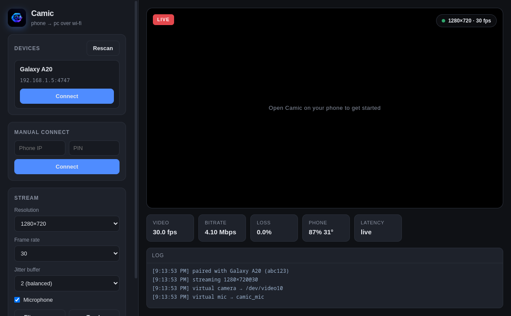
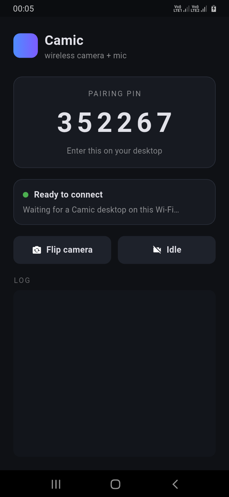

# Camic

Turn your phone's **camera + microphone** into a wireless webcam and mic for your computer — over the same Wi-Fi. Your phone shows up as a **real system camera and microphone**, so Zoom / Teams / OBS / browsers use it natively.

| Desktop receiver | Android app |
|---|---|
|  |  |

```
Phone (Android)  ──H.264 + AAC over Wi-Fi──►  PC (Linux)
 Camera2               UDP :4748 + TCP :4747      v4l2loopback + PipeWire
 MediaCodec            mDNS auto-discovery         "Camic Camera" + "camic_mic"
```

- **~60–120 ms** glass-to-glass latency on a clean LAN (hardware encode on the phone).
- **Auto-discovery** via mDNS, plus a **6-digit pairing PIN** so neighbours can't connect.
- Real virtual devices: **v4l2loopback + PipeWire** on Linux.

---

## Install — pick your distro

All downloads come from GitHub Releases.
Linux packages (`.deb`/`.rpm`/AppImage/tar.gz): **[v1.0.3](https://github.com/ThePraveenEffect/camic/releases/tag/v1.0.3)**.
Android APK: **[v1.0.3](https://github.com/ThePraveenEffect/camic/releases/tag/v1.0.3)** (latest).
SHA256 checksums: [SHA256SUMS](https://github.com/ThePraveenEffect/camic/releases/download/v1.0.3/SHA256SUMS) ·
[older v1.0.2](https://github.com/ThePraveenEffect/camic/releases/download/v1.0.2/SHA256SUMS).

### Fedora / RHEL / CentOS (`.rpm`)

```bash
sudo dnf install https://github.com/ThePraveenEffect/camic/releases/download/v1.0.3/Camic-1.0.3-x86_64.rpm
```

### Ubuntu / Debian (`.deb`)

```bash
mkdir -p ~/Downloads/camic && cd ~/Downloads/camic
curl -LO https://github.com/ThePraveenEffect/camic/releases/download/v1.0.3/Camic-1.0.3-amd64.deb
sudo apt install ./Camic-1.0.3-amd64.deb
```

> `apt install ./file.deb` resolves dependencies from Ubuntu's own repos.

### Any other Linux — AppImage (no install, portable)

```bash
mkdir -p ~/Downloads/camic && cd ~/Downloads/camic
curl -LO https://github.com/ThePraveenEffect/camic/releases/download/v1.0.3/Camic-1.0.3-x86_64.AppImage
chmod +x Camic-1.0.3-x86_64.AppImage
./Camic-1.0.3-x86_64.AppImage
```

If your distro doesn't ship FUSE 2 (Arch, some minimal installs), either
`sudo pacman -S fuse2` / `sudo apt install libfuse2t64`, or run without FUSE:

```bash
APPIMAGE_EXTRACT_AND_RUN=1 ./Camic-1.0.3-x86_64.AppImage
```

### Portable tarball (no root, no package manager)

```bash
mkdir -p ~/Downloads/camic && cd ~/Downloads/camic
curl -LO https://github.com/ThePraveenEffect/camic/releases/download/v1.0.3/Camic-1.0.3-x64.tar.gz
tar -xzf Camic-1.0.3-x64.tar.gz
./Camic-1.0.3-x64/camic-desktop
```

### Android (`.apk`)

1. On your phone, open:
   **https://github.com/ThePraveenEffect/camic/releases/download/v1.0.3/camic-1.0.3-android.apk**
2. Allow **Install from this source** / **Install unknown apps** when prompted.
3. Open **Camic**, grant **Camera** and **Microphone**.
4. Note the **pairing PIN** shown on screen.

> Android 8.0+ (minSdk 24). Runs as a foreground service so it keeps streaming
> with the screen off or when you switch apps.

### From source

```bash
# desktop (Linux receiver)
cd desktop && npm install && npm start

# android
cd mobile && flutter build apk --release
# -> mobile/build/app/outputs/flutter-apk/app-release.apk
```

---

## One-time Linux host setup

The PC needs the **v4l2loopback** kernel module (virtual webcam) and open firewall ports:

```bash
sudo ./scripts/setup-linux-host.sh
```

This loads `v4l2loopback` with the label `Camic Camera`, creates the `camic_mic`
PulseAudio/PipeWire sink, and opens UDP `4748` + TCP `4747` in `firewalld`/`ufw`.

Manual equivalent:

```bash
sudo modprobe v4l2loopback card_label="Camic Camera" exclusive_caps=1
# persist across reboots:
echo v4l2loopback | sudo tee /etc/modules-load.d/camic.conf
echo 'options v4l2loopback card_label="Camic Camera" exclusive_caps=1' | \
  sudo tee /etc/modprobe.d/camic.conf
```

---

## Usage

1. On the phone: open **Camic**, grant camera + mic. It advertises itself on the Wi-Fi.
2. On the PC: launch **Camic**. Your phone appears under *Devices* — hit **Connect**
   and type the PIN (or enter the IP + PIN manually).
3. Pick **Camic Camera** / **Camic Microphone** in Zoom, Teams, OBS or your browser.

---

## Verify a download

Grab the [SHA256SUMS](https://github.com/ThePraveenEffect/camic/releases/download/v1.0.3/SHA256SUMS)
(covers Linux packages and the Android APK), then:

```bash
cd ~/Downloads/camic
curl -LO https://github.com/ThePraveenEffect/camic/releases/download/v1.0.3/SHA256SUMS
sha256sum -c SHA256SUMS --ignore-missing
```

---

## Building the installers

```bash
# 1. Electron dir build (no installers)
cd desktop && npx electron-builder --linux dir && cd ..

# 2. native .deb + .rpm from that output
scripts/build-linux-packages.sh          # both
scripts/build-linux-packages.sh deb      # Ubuntu/Debian only
scripts/build-linux-packages.sh rpm      # Fedora only

# 3. AppImage + tar.gz
cd desktop && npx electron-builder --linux AppImage tar.gz
```

`scripts/build-linux-packages.sh` needs `ar`, `tar`, `fakeroot` (for `.deb`) and
`rpmbuild` (for `.rpm`) — it does **not** need `dpkg` or `fpm`.

| Package | Built where |
|---|---|
| `.deb`, `.rpm` | `scripts/build-linux-packages.sh` (any distro) |
| `AppImage`, `tar.gz` | `npx electron-builder` anywhere |
| `.apk` | `flutter build apk --release` |
| Flatpak / Snap | `packaging/flatpak/`, `snap/` (see `docs/PUBLISHING.md`) |

---

## Testing without a phone

The fake-phone harness speaks the real protocol and streams synthetic video:

```bash
# terminal 1 — start the fake phone (streams to your PC's IP)
cd tools
node fake-phone.js --desktop <your-pc-ip> --pin 123456

# terminal 2 — full receive-path test (no GUI)
node integration-test.js
```

Receiver unit tests (packet reassembly, corrupt-frame handling):

```bash
node /tmp/opencode/video-recv-test.js desktop/src/main/videoReceiver.js
```

---

## Repository layout

```
camic/
├── protocol/            Wire spec (PROTOCOL.md) + JSON schemas
├── mobile/              Flutter app (Android + iOS)
│   ├── lib/             UI, TCP control server, UDP packetizer, native bridge
│   ├── android/         Kotlin: Camera2 + MediaCodec H.264/AAC, mDNS (NsdManager)
│   └── ios/             Swift: VideoToolbox + AudioToolbox (build on a Mac)
├── desktop/             Electron app (Linux + Windows)
│   ├── src/main/        discovery, TCP control, UDP+jitter receiver, virtual devices
│   ├── src/renderer/    UI + WebCodecs H.264 preview
│   └── native/windows/  DirectShow video + mic filters (MSVC) + build files
├── packaging/flatpak/   Flatpak manifest + desktop entry + metainfo
├── snap/                snapcraft.yaml + launcher assets
├── scripts/             host setup, installer packaging
├── tools/fake-phone/    Node test sender (synthetic H.264) — no phone needed
└── docs/                architecture, build, publishing, user guide
```

## Documentation

- [`docs/USER_GUIDE.md`](docs/USER_GUIDE.md) — end-user setup
- [`docs/PUBLISHING.md`](docs/PUBLISHING.md) — apt / dnf / Flatpak / Snap release process
- [`docs/ARCHITECTURE.md`](docs/ARCHITECTURE.md) — how the pipeline works
- [`docs/BUILD_ANDROID.md`](docs/BUILD_ANDROID.md) — building the Android APK
- [`docs/BUILD_WINDOWS_DLL.md`](docs/BUILD_WINDOWS_DLL.md) — building the Windows filters
- [`protocol/PROTOCOL.md`](protocol/PROTOCOL.md) — the wire protocol

## Status

| Part | State |
|---|---|
| Protocol + fake-phone test harness | ✅ done, integration test passes |
| Linux desktop receiver (Electron) | ✅ v1.0.2 released — `.deb`/`.rpm`/AppImage/tar.gz |
| Android app (Flutter + MediaCodec) | ✅ APK v1.0.1 released — real launcher icon + fix for stale "connected" after the PC drops |
| Flatpak / Snap | 🟡 manifests written, not yet published |
| Windows DirectShow filters | 🟡 scaffolded — **must be built/tested on Windows (MSVC)** |
| iOS (VideoToolbox/AudioToolbox) | 🟡 scaffolded — **must be built/tested on a Mac** |

## License

MIT
